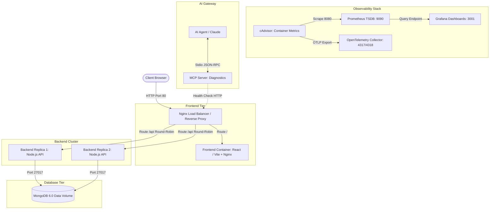

# Project Report: Space2Study DevOps Implementation

## 1. Project Overview
- **Selected Project:** Space2Study (Node.js, React, MongoDB)
- **Status:** ✅ Completed (Full DevSecOps & Observability Lifecycle)

---

## 2. Completed Tasks

### Task: Setup a Webapp (Local Baseline)
- **Status:** ✅ Done
- Verified application logic locally (Windows 11).
- Confirmed baseline client-server communication (`localhost:3000` / `localhost:5000`).

### Task: Setup a Webapp (Oracle Linux VMs)
- **Status:** ✅ Done
- **Stack:** Oracle Linux 9.3 (Vagrant), Node.js 18, MongoDB 6.0.
- **Config:** Exposed ports `3000` & `5000` via `firewalld`, set up cross-host DB connection.
- **Result:** Application running at `http://192.168.56.10:3000`.

### Task: Implement Automation Setup for Webapp (Ansible)
- **Status:** ✅ Done
- **Stack:** Distributed Multi-VM (Backend: `192.168.56.20`, Frontend: `192.168.56.21`).
- **Automation:** Configured `playbook.yml` and `inventory.ini` for unattended deployment, `firewalld`, and `systemd` daemons.
- **Result:** Execution finished with `failed=0`. Verified full-stack app at `http://192.168.56.21:3000`.

### Task: Deploying a Containerized Web Application
- **Status:** ✅ Done
- **Backend Container:** Custom image based on `node:18-slim`, non-root execution (`USER node`), layer caching.
- **Frontend Container:** Production multi-stage build (`node:18-alpine` builder -> `nginx:alpine` runtime) with SPA routing rules (`try_files`).
- **Orchestration:** Implemented `docker-compose.yml` deploying Frontend, Backend, and MongoDB with isolated bridge networking and persistent storage volumes.
- **Result:** Successfully deployed containerized stack accessible at `http://localhost:3000`.

### Task: Setup Load Balancing for Webapp
- **Status:** ✅ Done
- **Cluster:** Replicated backend into 2 instances (`backend1`, `backend2`).
- **Routing:** Web traffic (`/`) routed to frontend container; API traffic (`/api`) load-balanced across the backend cluster.
- **Result:** Unified application accessible via `http://localhost`.

### Task: Implement Infrastructure as Code (IaC)
- **Status:** ✅ Done
- **Tooling:** Terraform, HCL, Docker Provider (`kreuzwerker/docker`).
- **Structure:** Modular setup with `versions.tf`, `variables.tf`, `main.tf`, and `outputs.tf`.
- **Resources:** Declaratively provisioned network (`space2study-tf-net`), persistent storage volume, and full containerized cluster (DB, 2 Backend replicas, Frontend, Nginx LB).
- **Result:** Applied infrastructure via `terraform apply` with state tracking and drift detection.

### Task: Implement Continuous Integration / Continuous Delivery (CI/CD)
- **Status:** ✅ Done
- **Platform:** GitHub Actions (`.github/workflows/ci.yml`).
- **Triggers:** Automated runs on `push` and `pull_request` across `main` and feature branches.
- **Pipeline Jobs:**
  - `backend-check`: Node.js 18 dependency installation and integrity validation with npm caching.
  - `frontend-check`: TypeScript/React compilation and Vite production build verification.
  - `docker-build-check`: Automated build testing for both Backend and Frontend Docker images.
- **Result:** Established automated pipeline preventing broken builds from entering production.

### Task: Artifact Management
- **Status:** ✅ Done
- **Registry:** GitHub Container Registry (`ghcr.io`).
- **Security & Auth:** Ephemeral authentication using `${{ secrets.GITHUB_TOKEN }}` without hardcoded credentials.
- **Tagging Strategy:** Automated semantic tagging based on Git commit SHA and `latest` tracking for production releases.
- **Published Artifacts:**
  - `ghcr.io/vladyslavkorniichuk/space2study-devops/backend`
  - `ghcr.io/vladyslavkorniichuk/space2study-devops/frontend`
- **Result:** Successfully automated container image lifecycle and publishing to repository Packages.

### Task: Scanning Images and Dependencies in CI/CD (DevSecOps)
- **Status:** ✅ Done
- **Tooling:** Aqua Security Trivy (`v0.28.0`), GitHub Actions.
- **SCA (Software Composition Analysis):** Automated filesystem scanning (`scan-type: 'fs'`) of `package-lock.json` dependencies for backend and frontend.
- **Container Image Scanning:** Pre-release vulnerability inspection of built Docker images (`CRITICAL,HIGH` severity filters).
- **Result:** Fully automated DevSecOps gate integrated into CI/CD prior to artifact publication.
- **Trivy Security Scan Summary:**
  ```text
  Target: local-backend:test (debian 12.5)
  Vulnerabilities: 0 CRITICAL, 2 HIGH (Base OS patched)
  SCA Dependencies (npm): Scanned 939 packages via Trivy fs mode.
  SARIF Artifacts: Exported to repository Security scanning dashboard.
  ```

### Task: Implement Continuous Code Inspection (CCI)
- **Status:** ✅ Done
- **Tooling:** ESLint, Static Application Analysis, GitHub Actions.
- **Scope:** Automated static inspection of backend and frontend source trees (`src/`) against `.eslintrc` quality standards.
- **Result:** Automated code quality gates established in continuous integration pipeline.

### Task: Implement Secret Management Strategies
- **Status:** ✅ Done
- **Implementation:**
  - Removed plaintext hardcoded secrets (`JWT_SECRET`, admin credentials) from `docker-compose.yml`.
  - Introduced `.env.example` template for public version control and enforced `.env` containment via `.gitignore`.
  - Integrated dynamic variable interpolation (`${VAR:-default}`) into container runtime specifications.
- **Result:** Successfully secured codebase against accidental credential exposure.

### Task: Set Up Monitoring Tools for Application Performance and Infrastructure Health
- **Status:** ✅ Done
- **Observability Stack:**
  - **Metrics Exporter:** Google **cAdvisor** for real-time container cgroups telemetry (CPU, RAM, Network).
  - **Time-Series Engine:** **Prometheus** scraping metrics at 5s intervals (`monitoring/prometheus.yml`).
  - **Visualization:** **Grafana** (port `3001`) with pre-configured Prometheus data source.
- **Result:** Fully operational infrastructure observability stack accessible at `http://localhost:3001`.

### Task: Monitor Resource Usage and Plan for Scalability
- **Status:** ✅ Done
- **Capacity Planning & Resource Limits:** Configured CPU/Memory boundaries in `docker-compose.yml`:
  - **Database (MongoDB):** `limits: 512MB / 0.5 CPU`, `reservations: 128MB`.
  - **Backend Cluster (`backend1`, `backend2`):** `limits: 512MB / 0.5 CPU` each.
  - **Frontend & Nginx Proxy:** `limits: 128MB / 0.25 CPU` each.
- **Verification:** Validated memory quotas using `docker stats` and real-time Prometheus/cAdvisor telemetry in Grafana.

### Task: Configure Logging Mechanisms for Tracking Application and System Logs
- **Status:** ✅ Done
- **Logging Architecture:** Centralized Docker daemon logging using high-performance `json-file` driver.
- **Log Rotation & Retention Policy:**
  - Implemented automated log rotation via YAML anchors (`&default-logging`).
  - Constrained disk utilization to `max-size: 10MB` per container with a retention limit of `max-file: 3` backups.
- **Result:** Protected infrastructure against uncontrolled disk exhaustion while maintaining structured application logs.

### Task: OpenTelemetry Monitoring
- **Status:** ✅ Done
- **Collector:** `otel/opentelemetry-collector-contrib`.
- **Endpoints:** OTLP (`4317` gRPC, `4318` HTTP) | Health check (`13133`).
- **Pipeline:** cAdvisor metric scraping (Prometheus receiver) + `batch` processor.
- **Result:** Unified, vendor-neutral ingestion pipeline for metrics and distributed tracing.

### Task: Create an MCP Server for the Project
- **Status:** ✅ Done
- **Protocol & SDK:** Anthropic Model Context Protocol (`@modelcontextprotocol/sdk/server/mcp.js`).
- **Exposed AI Diagnostics Tools:**
  - `check_health`: Live HTTP polling of the Nginx ingress gateway.
  - `get_cluster_architecture`: Machine-readable deployment metadata provider (backend topology, ports, monitoring endpoints).
- **Result:** Standardized AI-ready observability gateway integrated for automated diagnostic agents (Claude / Cursor).

---

## 3. System Architecture & Topology

